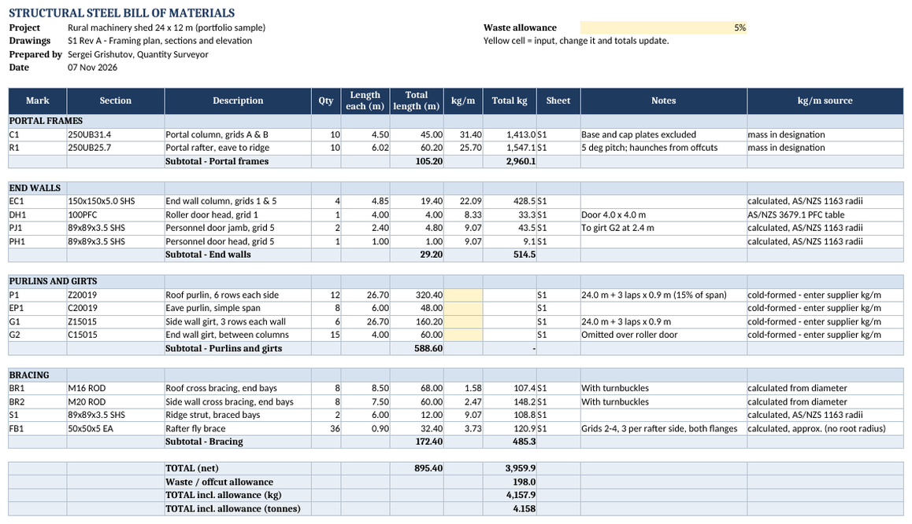
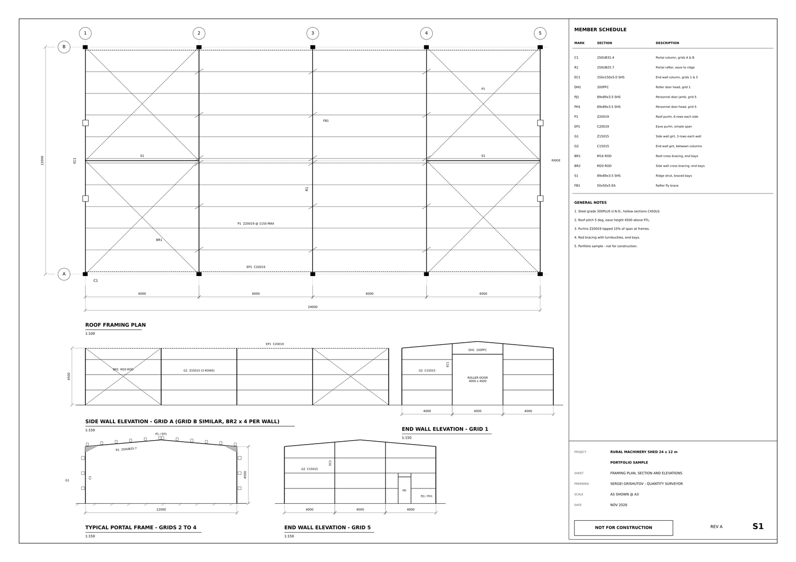
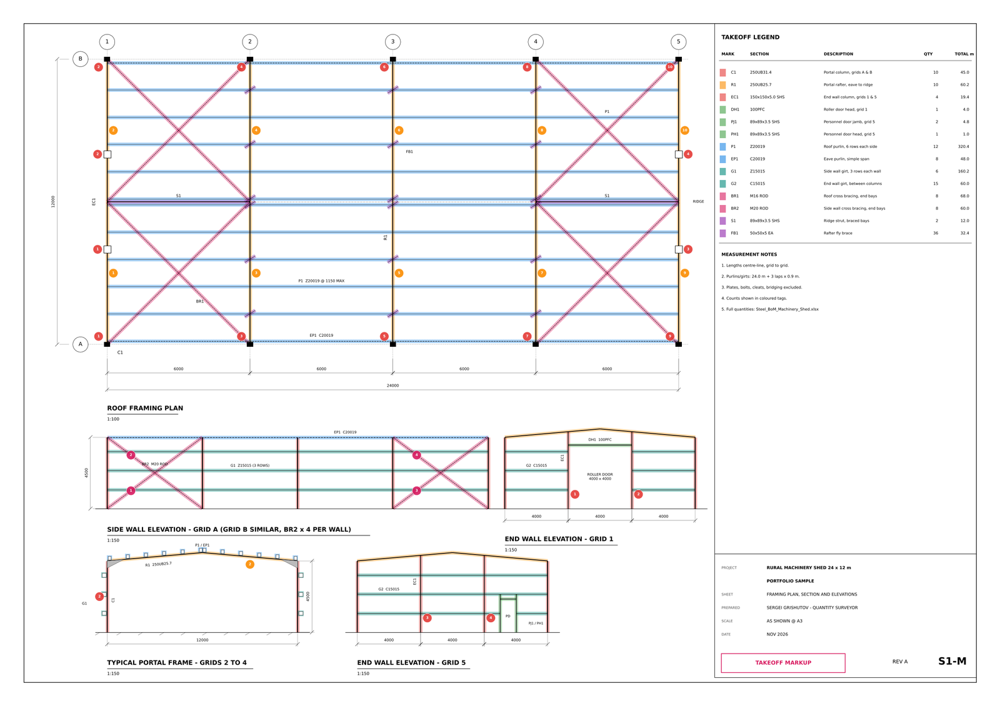

# Steel takeoff tools

Small Python tools I use for structural steel takeoffs: turn a member list into a clean Excel bill of materials with weights, subtotals and a waste allowance, and get kg/m for common sections straight from the designation.



## What's inside
| File | What it does |
| --- | --- |
| `steel_sections.py` | kg/m from a section designation: Australian UB/UC/WB/PFC, US W/C/MC/S/HP, SHS/RHS/CHS, angles and rod bracing |
| `bom_builder.py` | Member list (CSV) → Excel BoM: grouped by category, live formulas, subtotals, waste %, summary by section and category, notes sheet |
| `sections_custom.csv` | Your own kg/m values (cold-formed purlins and girts, other catalogues). Read first, overrides the calculation |
| `tests.py` | Spot checks against published catalogue values |
| `example/` | A complete worked example: a 24 x 12 m portal-frame shed (sample drawing) |

## Quick start
```bash
pip install openpyxl
python steel_sections.py "310UB40.4" "150x150x6.0 SHS" "100PFC" "M20 ROD"
python bom_builder.py example/members.csv -o Steel_BoM.xlsx --project "My project" --waste 5
```

Member list columns: `category, mark, section, description, qty, length_m, sheet, notes` (optional `kg_per_m` to override a line).

## Worked example: portal-frame shed
A sample A3 framing sheet, my colour takeoff markup of it, and the BoM built from the member list.

| Drawing | Takeoff markup |
| --- | --- |
|  |  |

- `example/S1_Machinery_Shed_Framing.pdf` – the drawing (portfolio sample)
- `example/S1_Machinery_Shed_Takeoff_Markup.pdf` – every member colour-coded by type, with count tags and a legend
- `example/members.csv` – the measured member list
- `example/Steel_BoM_Machinery_Shed.xlsx` – the bill of materials

Result: 895 m of steel, 3.96 t net of hot-rolled and hollow sections, 4.16 t with a 5 % allowance. Purlins and girts are measured in metres, as roll-formers price them.

## How the weights are worked out
- **Hot-rolled sections** (UB, UC, WB, W, C): the mass is part of the designation.
- **PFC**: AS/NZS 3679.1 catalogue table.
- **SHS / RHS**: cross-section area with AS/NZS 1163 corner radii (outside radius 2t up to 3 mm wall, 2.5t above), density 7850 kg/m³.
- **CHS, rods**: from diameter and wall thickness.
- **Angles**: t(b + d − t), root radius ignored (within about 1 %).
- **Cold-formed C and Z purlins**: not calculated, because profiles differ between manufacturers. Add the supplier value to `sections_custom.csv`.

Always check final weights against the supplier catalogue before ordering.

## Typical scope I deliver with these tools
- Marked-up PDF: every member colour-coded with counts
- Excel BoM: mark, section, quantity, lengths, kg/m, total kg, sheet reference
- Notes: assumptions, exclusions (plates, bolts, cleats) and items to confirm with the engineer

## License
MIT. Written with AI assistance and checked by me against catalogue values.
